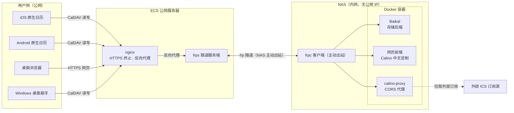
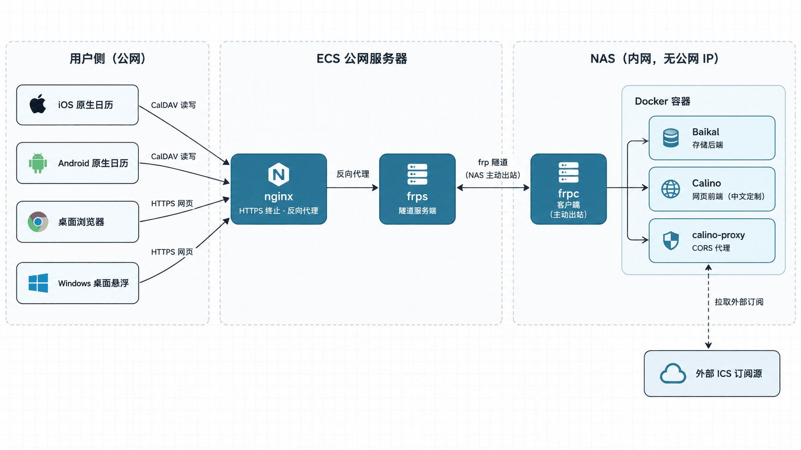
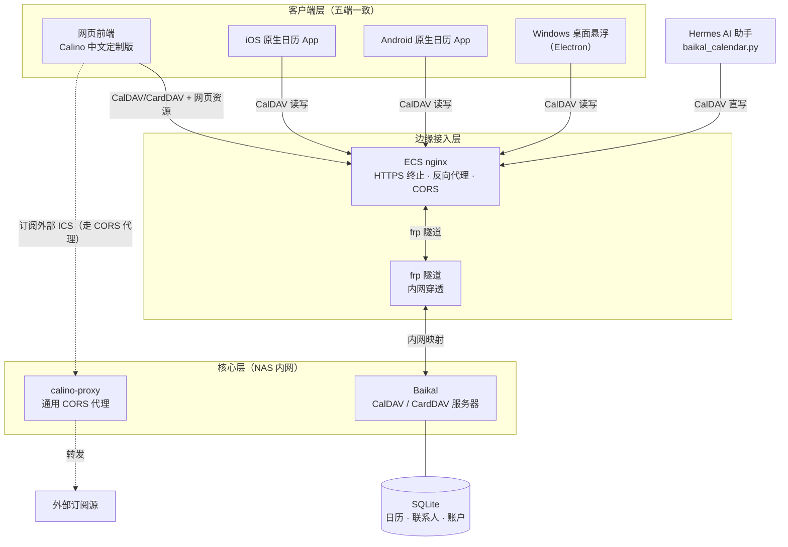
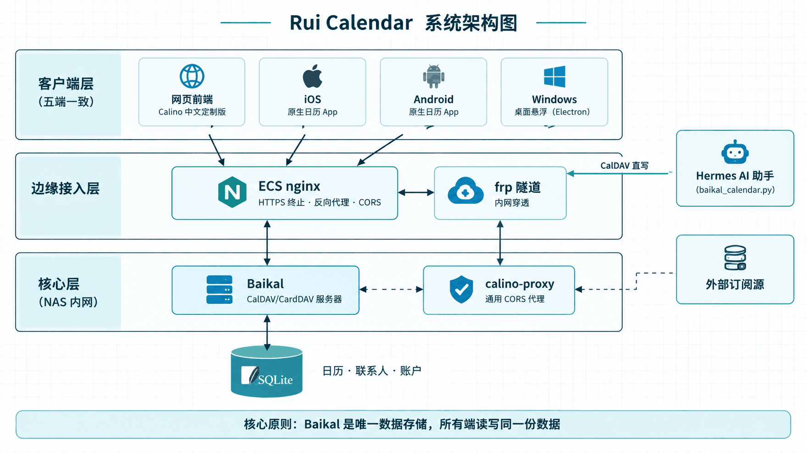
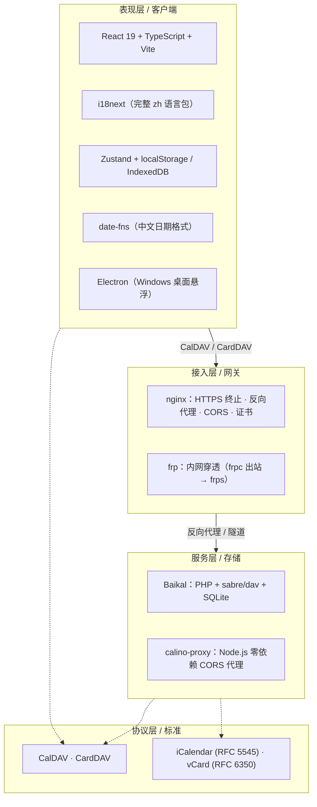
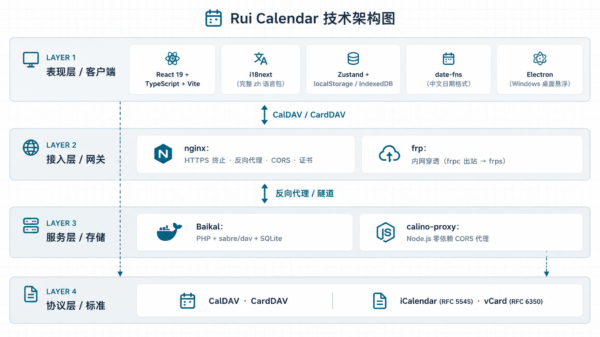
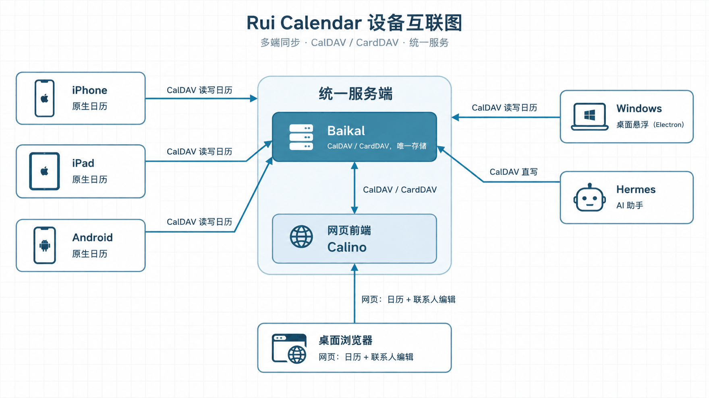

<p align="center">
  
</p>

<h1 align="center">Rui Calendar（瑞历）</h1>

<p align="center">
  <b>把日历、联系人、待办从云服务商手里拿回来，装进你自己的服务器</b><br/>
  网页 · iPhone/iPad · Android · Windows 桌面，五端读写同一份数据
</p>

<p align="center">
  🌐 <a href="https://vector9584.github.io/rui-calendar/">应用主页</a> ·
  ⬇️ <a href="https://github.com/vector9584/rui-calendar/releases/latest">下载桌面版</a> ·
  <a href="#能做什么">能做什么</a> ·
  <a href="#架构">架构</a> ·
  <a href="#组件清单">组件</a> ·
  <a href="#桌面客户端">桌面客户端</a> ·
  <a href="#快速开始">快速开始</a> ·
  <a href="#文档">文档</a> ·
  <a href="JOURNEY.md">心路历程</a>
</p>

---

## 能做什么

**一句话：把日历、联系人、待办全部收回到你自己的服务器上，数据只存在你的机器里，不经过任何第三方。**

往下拆成三件事，这是这套系统真正的用途：

### 1. 你拥有自己的日历，而不是租用日历

底层是一台 CalDAV / CardDAV 服务器（[Baikal](https://sabre.io/baikal/)，PHP + sabre/dav + SQLite）。它在你的机器上存着：

- **日历**：多本日历、多用户、颜色标签，随便建，不占用任何云盘配额。
- **联系人**：地址簿（CardDAV），手机通讯录可以直连。
- **待办**：任务列表（VTODO），和日历事件一起管理。

数据落盘在你自己的 SQLite 里，删了、导了、备份了，都是你说了算。没有「某某云服务条款更新后数据没了」这回事。

### 2. 网页客户端：中文界面，管日历、联系人和待办

网页前端（Calino 中文定制版）基于 [Calino](https://github.com/Ivan-Malinovski/calino)（MIT）深度中文化定制，功能齐全：

- **看日历**：月 / 周 / 3 天 / 日 / 议程 / 年，多种视图，拖拽移动和缩放事件。
- **建日程**：用大白话直接输入「周五下午三点开会」，自动解析成日程（自然语言，无需 AI）。
- **记日记**：内置日记（VJOURNAL），支持 Markdown。
- **管联系人**：地址簿自动识别，卡片式管理。
- **搜一切**：全文模糊搜索，翻几十个日程秒找到。
- **提醒**：桌面通知，可自定义提醒时间。
- **深浅主题**：亮色 / 暗色 / 跟随系统，还能自己加主题。

### 3. 五端同步 + 订阅 + AI，把它变成日常工具

- **多端同步**：网页端、iPhone/iPad 原生日历 App、Android 原生日历 App，都直连同一个 Baikal，改一处处处更新。桌面端还有独立的悬浮小组件（见下文）。
- **订阅外部日历**：开箱即用 6 个中文订阅源——老黄历（宜/忌）、法定节假日、节日节气、星座运势、天气（全国省市县三级联动，34 省 412 城 3577 区县）。
- **AI 帮你写日历**：AI 助手（Hermes）通过一个零依赖脚本直接走 CalDAV 协议写日程，你说「帮我加个下周二去医院的提醒」，它就能落到日历里并同步到所有端。
- **公网穿透**：NAS 没有公网 IP 也能在外网用——ECS nginx 做 HTTPS 终止，frp 隧道（NAS 主动出站）把内网服务映射到公网独立端口，不碰 80/443 主站。

---

## 特性

### 中文优先

- 完整中文界面，覆盖日历、设置、引导、弹窗全部文案。
- 中文日期格式：天视图「周一 | 10月26日」、周视图「10月28日 – 11月3日」、详情弹窗「2026年10月23日」。
- 品牌名「瑞历」采用开源毛笔书法字体（马善政楷书，OFL 许可）子集化本地引入。

### 数据自主

- 日历、联系人、账户全部存在你自己的 Baikal 服务器（SQLite），不经过任何第三方。
- 多用户、多日历、地址簿，颜色字段原生支持。
- 认证走标准 Basic auth，任何 CalDAV 客户端都能接。

### 安全与隐私

- 外网资源全本地化：移除 Google Fonts 和 jsdelivr 依赖，CSP 收紧到 `'self'`，断网/内网可用。
- CORS 代理内置 SSRF 防护（默认阻断环回/内网/链路本地/云元数据地址）。

---

## 架构

四张图从不同视角描述这套系统。每节两张：先看手绘示意图，再往下是同样内容的 mermaid 源码（可直接改）。

### 1. 网络拓扑图

流量如何从公网一路走到内网容器：用户设备 → 公网 ECS（nginx 入口）→ frp 隧道（NAS 主动出站）→ 内网 Docker 容器。



<p align="center">
  
</p>

### 2. 系统架构图

逻辑组件与数据流。核心原则：**Baikal 是唯一数据存储，所有端读写同一份数据**。



<p align="center">
  
</p>

### 3. 技术架构图

每一层用什么技术栈。



<p align="center">
  
</p>

### 4. 设备互联图

每台终端设备如何接入、分别连到哪个服务。


一句话总结：**瑞历（Rui Calendar）是这一整套方案的名字——Baikal 是唯一存储（日历 + 联系人），网页前端（Calino 中文定制）提供中文界面，iOS/Android 原生 App 直连 Baikal，Windows 桌面悬浮组件叠加其上，五端数据一致。** 网页前端是纯前端、无自有后端，所有数据通过 CalDAV / CardDAV 协议读写 Baikal。

<p align="center">
  
</p>

---

## 组件清单

「瑞历（Rui Calendar）」是这一整套解决方案的名字，下表是构成它的各个组件：

| 组件 | 职责 | 说明 |
|---|---|---|
| **Baikal** | CalDAV/CardDAV 存储后端 | Docker `ckulka/baikal:0.10.1-nginx`，SQLite，多用户/多日历/地址簿，唯一存储 |
| **网页前端** | 中文网页日历客户端 | 本仓库核心，基于 [Calino](https://github.com/Ivan-Malinovski/calino)（MIT）二次开发 |
| **瑞历桌面版** | Windows 桌面悬浮日历 | 本仓库 `desktop/`，Electron 打包，便携版 + 安装版 |
| **calino-proxy** | 通用 CORS 代理 | 本仓库 `proxy/`，零依赖 Node 服务，绕过外部 ICS 源的 CORS 限制 |
| **frpc / frps** | 内网穿透 | NAS 主动出站连公网 frps，映射 3 条隧道 |
| **nginx（ECS）** | 公网 HTTPS 入口 | 独立 ssl 端口，反代 + 证书终止 |
| **iOS/Android 原生日历** | 移动端读写 | 系统日历账户直连 Baikal，与网页端同一份数据 |
| **Hermes / AI 助手** | 程序化操作日历 | `deploy/hermes/baikal_calendar.py` 直写 Baikal，操作手册见 [`deploy/hermes/SKILL.md`](deploy/hermes/SKILL.md) |

---

## 桌面客户端

已完成，不再「规划中」。Windows 桌面悬浮日历，把网页前端包成一个桌面小组件，源码在本仓库 [`desktop/`](desktop/)。

### 功能

- **悬浮 / 置顶**：可普通悬浮在桌面，或置顶在所有窗口之上。
- **透明度**：5% ~ 100% 可调。
- **锁定**：锁定后点击穿透、隐藏顶部栏，只能通过系统托盘菜单解锁。
- **开机启动**：登录 Windows 后自动运行。
- **顶部栏**：关闭（隐藏到托盘）、刷新、设置三个按钮。
- **托盘菜单**：悬浮 / 锁定 / 开机启动（红=关，绿=开）、设置、退出。
- **主题跟随**：顶部栏颜色随网页明暗主题实时切换。
- **无滚动条**：页面自适应填满窗口。

### 下载

两种打包形式，均基于 Electron，已发布到 [GitHub Releases](https://github.com/vector9584/rui-calendar/releases/latest)：

- **便携版（免安装）**：[Rui-Calendar-1.1.0-portable.exe](https://github.com/vector9584/rui-calendar/releases/latest/download/Rui-Calendar-1.1.0-portable.exe)，双击直接运行，免安装。
- **安装版**：[Rui-Calendar-1.1.0-setup.exe](https://github.com/vector9584/rui-calendar/releases/latest/download/Rui-Calendar-1.1.0-setup.exe)，按向导安装，带桌面/开始菜单快捷方式。

### 构建

```bash
cd desktop
npm install
npm start               # 本地运行
npm run dist            # 构建安装版 + 便携版（产物在 dist/）
npm run dist:portable   # 仅构建便携版
```

默认内嵌的日历地址在 [`desktop/main.js`](desktop/main.js) 顶部的 `CALENDAR_URL`，替换成你自己的网页前端地址后重新构建即可。

---

## 快速开始

前端开发：

```bash
pnpm install
pnpm dev          # 本地开发
pnpm build        # 产物在 dist/
```

完整部署（Baikal + 网页前端 + proxy + frp + nginx + iOS + AI 助手）见 [deploy/README.md](deploy/README.md)。

---

## 文档

| 文档 | 内容 |
|---|---|
| [应用主页](https://vector9584.github.io/rui-calendar/) | 在线介绍页（卡片式，含下载地址） |
| [JOURNEY.md](JOURNEY.md) | 完整心路历程：从调研 Y日历 到落地这套系统的决策与踩坑 |
| [deploy/README.md](deploy/README.md) | 部署手册：Baikal → 网页前端 → 代理 → 隧道 → nginx → iOS → AI 集成 |
| [desktop/README.md](desktop/README.md) | 桌面悬浮客户端：功能、安装、构建 |
| [deploy/hermes/SKILL.md](deploy/hermes/SKILL.md) | Hermes AI 助手操作手册（可直接作为 Hermes skill 使用） |
| [deploy/hermes/baikal_calendar.py](deploy/hermes/baikal_calendar.py) | 零依赖 CalDAV 写入 helper |
| [deploy/hermes/test_baikal_calendar.py](deploy/hermes/test_baikal_calendar.py) | helper 回归测试 |

---

## 脱敏说明

本仓库由作者的私有部署脱敏而来，不含任何真实域名、IP、端口、密钥或凭据：

- 引导弹框预填的 CalDAV 服务器地址、订阅源域名、代理路径等已替换为占位符。
- 部署配置（nginx / frpc / Hermes 脚本）均为 `*.example` 模板，端口为示例值，clone 后替换成你的真实地址即可。
- `desktop/main.js` 的日历地址为占位符，构建前替换。
- `deploy/hermes/SKILL.md` 中的真实域名、内网 IP、用户名、姓名均已脱敏。

---

## 许可证

本项目基于 [Calino](https://github.com/Ivan-Malinovski/calino)（MIT License，作者 Ivan Malinovski）二次开发。上游代码版权归 Ivan Malinovski 所有，中文化、品牌化及部署资产等新增部分遵循 [MIT License](LICENSE) 发布。桌面客户端（`desktop/`）为独立 MIT 项目，见 [desktop/LICENSE](desktop/LICENSE)。
