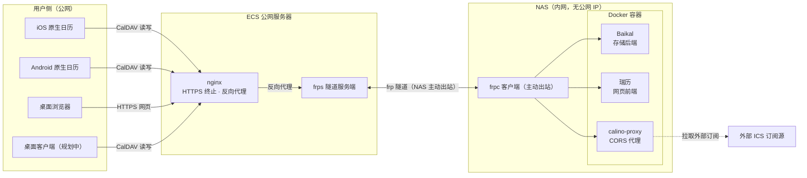
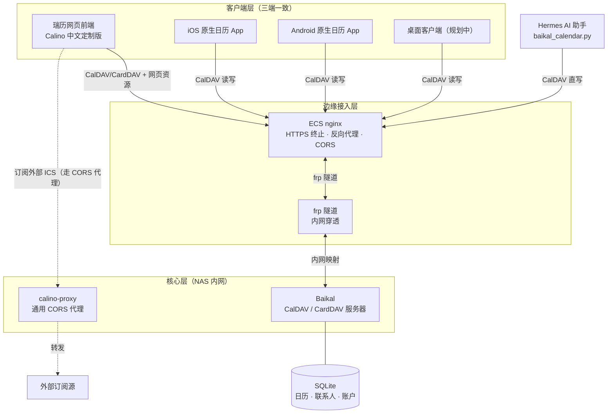
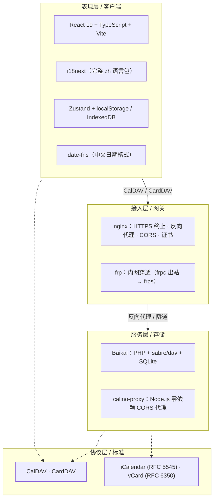
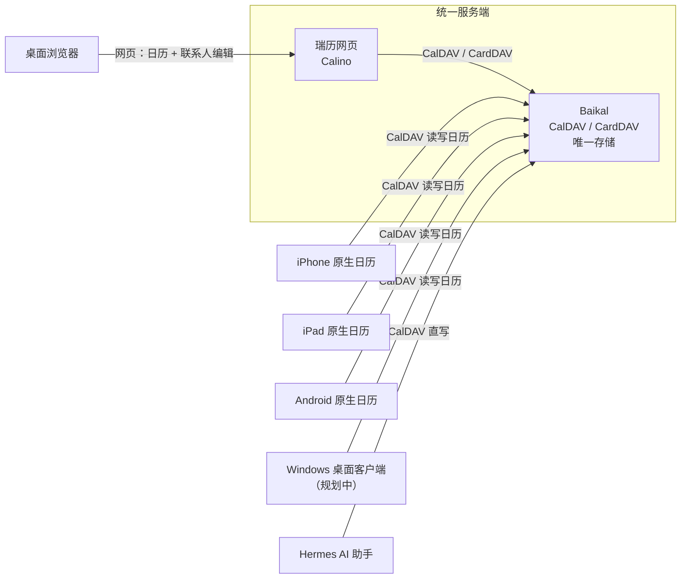

<p align="center">
  
</p>

<h1 align="center">Rui Calendar（瑞历）</h1>

<p align="center">
  <b>一套完全自托管的日历系统</b><br/>
  Baikal 存储 · 瑞历网页前端 · CORS 代理 · nginx/frp 公网穿透 · iOS/Android 原生直连 · AI 助手集成
</p>

<p align="center">
  <a href="#特性">特性</a> ·
  <a href="#架构">架构</a> ·
  <a href="#组件清单">组件</a> ·
  <a href="#快速开始">快速开始</a> ·
  <a href="#文档">文档</a> ·
  <a href="JOURNEY.md">心路历程</a>
</p>

---

## 这是什么

Rui Calendar（瑞历）是一套「数据完全归自己掌控」的日历基础设施，不是单个应用。

日历和联系人的数据存在你自己的服务器上；网页端、iPhone/iPad 原生日历 App、Android 原生日历 App，以及（规划中的）桌面客户端，都通过标准 CalDAV / CardDAV 协议读写**同一份数据**，三端实时一致。你还能订阅外部日历、把自建日程整合发布，甚至让 AI 助手直接帮你写日历。

数据层用老牌 CalDAV 服务器 [Baikal](https://sabre.io/baikal/)（PHP + sabre/dav + SQLite），前端是本仓库的**瑞历**——基于 [Calino](https://github.com/Ivan-Malinovski/calino)（MIT）深度定制的**中文版**网页日历客户端。

## 特性

### 中文优先

- 完整中文界面，覆盖日历、设置、引导、弹窗全部文案。
- 中文日期格式：天视图「周一 | 10月26日」、周视图「10月28日 – 11月3日」、详情弹窗「2026年10月23日」。
- 品牌名「瑞历」采用开源毛笔书法字体（马善政楷书，OFL 许可）子集化本地引入。

### 数据自主

- 日历、联系人、账户全部存在你自己的 Baikal 服务器（SQLite），不经过任何第三方。
- 多用户、多日历、地址簿，颜色字段原生支持。
- 认证走标准 Basic auth，任何 CalDAV 客户端都能接。

### 三端一致

- 网页端编辑、iOS/Android 原生日历 App 读写，指向同一个 Baikal，实时同步。
- 桌面客户端（Windows）规划中，同样走 CalDAV 连 Baikal。

### 内置中文订阅源

开箱即用 6 个订阅：老黄历（宜/忌）、法定节假日、节日节气、星座运势、天气。天气支持全国省市县三级中文联动下拉（34 省 412 城 3577 区县）。

### 公网穿透

NAS 无公网 IP 也能用——ECS nginx 做 HTTPS 终止 + 反代，frp 隧道（NAS 主动出站）把内网容器映射到公网**独立端口**，绝不碰 80/443 主站。

### AI 助手集成

AI 助手（Hermes）通过 `deploy/hermes/baikal_calendar.py` 直接走 CalDAV 协议写 Baikal，加日程/待办/提醒实时同步到所有端。操作手册见 [`deploy/hermes/SKILL.md`](deploy/hermes/SKILL.md)。

### 安全与隐私

- 外网资源全本地化：移除 Google Fonts 和 jsdelivr 依赖，CSP 收紧到 `'self'`，断网/内网可用。
- CORS 代理内置 SSRF 防护（默认阻断环回/内网/链路本地/云元数据地址）。

## 架构

四张图从不同视角描述这套系统。

### 1. 网络拓扑图

流量如何从公网一路走到内网容器：用户设备 → 公网 ECS（nginx 入口）→ frp 隧道（NAS 主动出站）→ 内网 Docker 容器。



### 2. 系统架构图

逻辑组件与数据流。核心原则：**Baikal 是唯一数据存储，所有端读写同一份数据**。



### 3. 技术架构图

每一层用什么技术栈。



### 4. 设备互联图

每台终端设备如何接入、分别连到哪个服务。



一句话总结：**Baikal 是唯一存储（日历 + 联系人），瑞历是漂亮的中文网页前端，iOS/Android 原生 App 直连 Baikal，三端数据一致。** 瑞历是纯前端、无自有后端，所有数据通过 CalDAV / CardDAV 协议读写 Baikal。

## 组件清单

| 组件 | 职责 | 说明 |
|---|---|---|
| **Baikal** | CalDAV/CardDAV 存储后端 | Docker `ckulka/baikal:0.10.1-nginx`，SQLite，多用户/多日历/地址簿，唯一存储 |
| **瑞历（Rui Calendar）** | 中文网页日历客户端 | 本仓库核心，基于 [Calino](https://github.com/Ivan-Malinovski/calino)（MIT）二次开发 |
| **calino-proxy** | 通用 CORS 代理 | 本仓库 `proxy/`，零依赖 Node 服务，绕过外部 ICS 源的 CORS 限制 |
| **frpc / frps** | 内网穿透 | NAS 主动出站连公网 frps，映射 3 条隧道 |
| **nginx（ECS）** | 公网 HTTPS 入口 | 独立 ssl 端口，反代 + 证书终止 |
| **iOS/Android 原生日历** | 移动端读写 | 系统日历账户直连 Baikal，与网页端同一份数据 |
| **Hermes / AI 助手** | 程序化操作日历 | `deploy/hermes/baikal_calendar.py` 直写 Baikal，操作手册见 [`deploy/hermes/SKILL.md`](deploy/hermes/SKILL.md) |

## 快速开始

前端开发：

```bash
pnpm install
pnpm dev          # 本地开发
pnpm build        # 产物在 dist/
```

完整部署（Baikal + 瑞历 + proxy + frp + nginx + iOS + AI 助手）见 [deploy/README.md](deploy/README.md)。

## 文档

| 文档 | 内容 |
|---|---|
| [JOURNEY.md](JOURNEY.md) | 完整心路历程：从调研 Y日历 到落地这套系统的决策与踩坑 |
| [deploy/README.md](deploy/README.md) | 部署手册：Baikal → 前端 → 代理 → 隧道 → nginx → iOS → AI 集成 |
| [deploy/hermes/SKILL.md](deploy/hermes/SKILL.md) | Hermes AI 助手操作手册（可直接作为 Hermes skill 使用） |
| [deploy/hermes/baikal_calendar.py](deploy/hermes/baikal_calendar.py) | 零依赖 CalDAV 写入 helper |
| [deploy/hermes/test_baikal_calendar.py](deploy/hermes/test_baikal_calendar.py) | helper 回归测试 |

## 桌面客户端

规划中：后续会补充一个 Windows 桌面客户端（可执行文件），同样通过 CalDAV 连 Baikal，与网页端 / iOS 读写同一份数据。落地后会在此仓库补充对应说明。

## 脱敏说明

本仓库由作者的私有部署脱敏而来，不含任何真实域名、IP、端口、密钥或凭据：

- 引导弹框预填的 CalDAV 服务器地址、订阅源域名、代理路径等已替换为占位符。
- 部署配置（nginx / frpc / Hermes 脚本）均为 `*.example` 模板，端口为示例值，clone 后替换成你的真实地址即可。
- `deploy/hermes/SKILL.md` 中的真实域名、内网 IP、用户名、姓名均已脱敏。

## 许可证

本项目基于 [Calino](https://github.com/Ivan-Malinovski/calino)（MIT License，作者 Ivan Malinovski）二次开发。上游代码版权归 Ivan Malinovski 所有，中文化、品牌化及部署资产等新增部分遵循 [MIT License](LICENSE) 发布。
